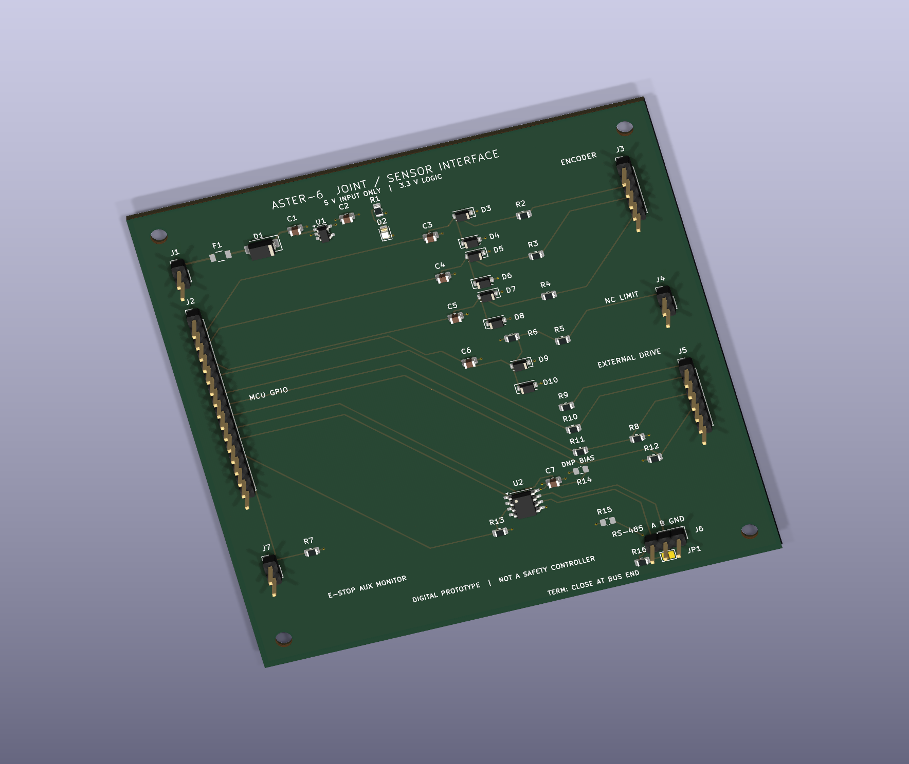

# Electronics & KiCad · Joint / sensor interface

[← Project home](../README.md) · [CAD](../01_CAD_Models/README.md) · [Theory](../03_Reports_and_Results/README.md)

**Start with the [illustrated circuit and PCB tour](../06_Complete_Project_Source/docs/electronics_tour.md).** Follow the regulated supply, encoder/limit inputs, external-drive commands and RS-485 interface, then match each block to the schematic and board.

**100 × 100 mm · Four copper layers · 44 schematic components · 48 PCB footprints including four mounting holes**

## Browse without KiCad

| Inspect | Open on GitHub |
|---|---|
| Circuit connections and values | [Schematic PDF](exports/joint_interface.pdf) · [Zoomable schematic SVG](exports/joint_interface.svg) |
| Board layout and references | [Top view](exports/pcb_top.png) · [Top copper SVG](exports/pcb_top.svg) · [Six-page layer PDF](exports/pcb_layers.pdf) |
| Ground, power and bottom routing | [Ground plane](exports/pcb_ground_plane.svg) · [Power plane](exports/pcb_power_plane.svg) · [Bottom copper](exports/pcb_bottom.svg) |
| Components and selection reasoning | [Component guide](../06_Complete_Project_Source/docs/electronics_components.md) · [BOM table](bom.csv) |
| Supply budget, filters and interface limits | [Electrical design chapter](../06_Complete_Project_Source/docs/05_electronics.md) · [Calculated values](interface_calculations.json) |
| Actual design-rule and connectivity evidence | [ERC](erc_report.json) · [DRC](pcb_drc_report.json) · [PCB verification](pcb_verification.json) |

References such as **U1**, **R5** or **J3** identify the same part in the schematic, layout and BOM. The tour explains the reference groups and **DNP** population choices.

## Open the KiCad project

1. Download and extract the **complete repository**, keeping this folder together.
2. Open [joint_interface.kicad_pro](joint_interface.kicad_pro) in **KiCad 10**, then choose the schematic or PCB editor.
3. On Windows, **OPEN_PCB_LAYOUT.cmd** in the parent folder opens the routed board directly.

| Native item | File |
|---|---|
| KiCad project | [joint_interface.kicad_pro](joint_interface.kicad_pro) |
| Schematic | [joint_interface.kicad_sch](joint_interface.kicad_sch) |
| Routed PCB | [joint_interface.kicad_pcb](joint_interface.kicad_pcb) |
| Project-local library table | [fp-lib-table](fp-lib-table) |
| Manufacturer-specific fuse land pattern | [ASTER_Interface.pretty](ASTER_Interface.pretty) |

Keep the library table and local footprint folder beside the project. F1 uses a Bourns MF-NSMF025X-2 land pattern stored here; downloading only the PCB omits part of the editable project. The 3D render shows F1's lands because a dedicated fuse body model is not supplied.

## Fabrication and source

[Fabrication ZIP](fabrication/joint_interface_fabrication.zip) · [Gerbers, drills and positions](fabrication) · [Assembly drawing](exports/pcb_assembly.svg) · [Source and verification commands](../06_Complete_Project_Source/electronics/README.md)

This is a digital low-voltage interface for an external controller and drive. The board has no MCU or motor power stage. The E-stop connection monitors an auxiliary contact; it does not implement torque interruption. Native checks and fabrication exports are review evidence, with physical thermal, EMC and manufacturing qualification outside the project scope.
