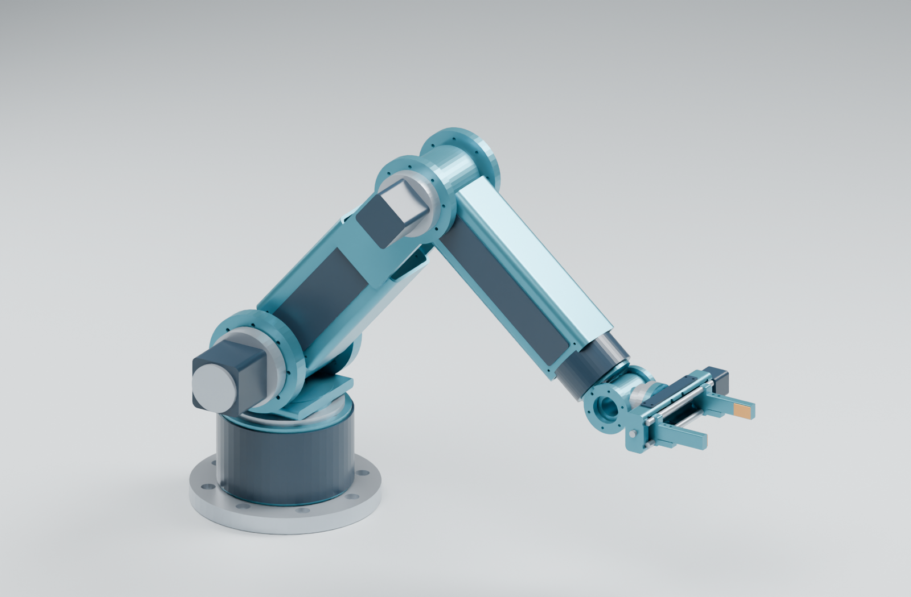
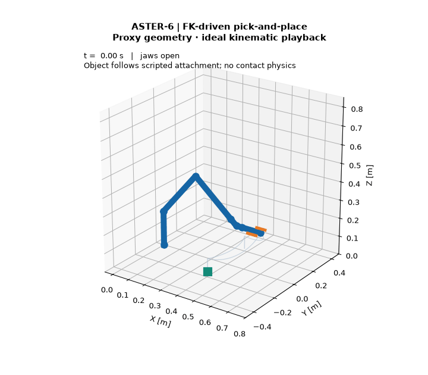
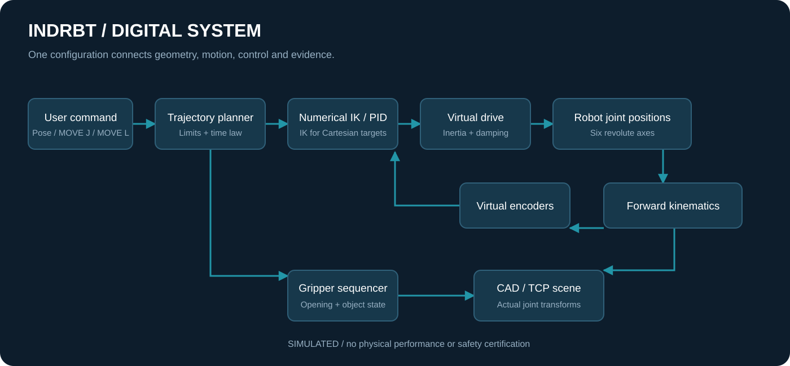
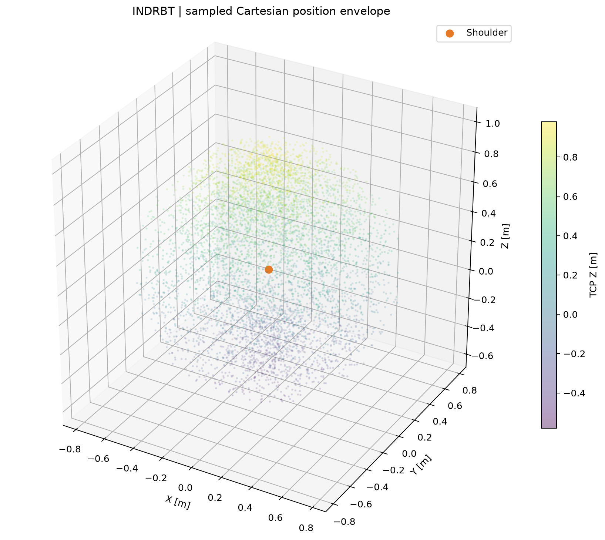

# INDRBT · Industrial robot arm digital twin

An original six-axis robot with parametric CAD, numerical kinematics and a reproducible pick-and-place simulation.



**Digital only · v1.2.0 · DIGITAL SCOPE COMPLETE**

Designed for robotics education and portfolio review. Every result is generated from source; no physical robot was built. Payload and repeatability remain design targets. The conceptual electronics include a routed PCB, manufacturing exports and native DRC; collision evidence is representative and sampled.

## Explore the project

[Repository home](../README.md) · [CAD tour](docs/cad_tour.md) · [Circuit and PCB tour](docs/electronics_tour.md) · [Engineering walkthrough](docs/engineering_walkthrough.md) · [Documentation index](docs/README.md)

For a visual introduction, start with these guides. This source README contains the installation, reproduction commands and detailed evidence map.

## See it move

Read [the project purpose and original goals](docs/project_alignment.md) for the engineering question, intended demonstration and relationship between the subsystems.

Open **[the offline interactive CAD twin](simulations/indrbt_twin.html)** locally: orbit, change all six joints, adjust the gripper, select poses and play the recorded task. The single HTML file needs no server or internet. GitHub displays its source; download it to open it in a browser.

The **CAD component** selector isolates and frames any of the 54 actual parts. Use the [component catalog](docs/component_catalog.md) to match part names, native objects, materials and STEP/STL files. The [theory guide](docs/theory_guide.md) connects the model equations to evidence, and the [electronics component guide](docs/electronics_components.md) explains references, selections and BOM population.



The 9.24 s task follows MOVE J and MOVE L segments: approach, grasp, lift, transport, release and return home. CAD meshes and animation use the actual transform chain. The grasp is an ideal attachment; contact physics is not simulated.

## Features and specifications

| Item | Value / evidence |
|---|---|
| Original geometry | 54 valid BRep components; 6 STEP/STL assemblies |
| DOF / link lengths | Six revolute joints / 320 mm upper arm + 280 mm forearm |
| Nominal reach | 790 mm from shoulder; nominal straight-up TCP height 980 mm above base |
| Payload / repeatability | 4 kg / ±0.1 mm **TARGET**, physically unverified |
| Mass basis | 23.65 kg assumed; separate 19.908 kg CAD envelope sum with stated limitations |
| Gripper | 90 mm opening; 200 N total force target; calculated screw torque 0.364 N·m |
| FK / IK / Jacobian | Bounded numerical IK; 60 perturbed-seed pose trials |
| Motion / control | Linear/cubic/quintic MOVE J, sampled MOVE L and saturated PID |
| Electronics | Native 44-component KiCad interface; 0 ERC violations under enabled default rules; routed PCB/native DRC and connectivity evidence |
| Tests | 91 tests; 0 failures; 0 errors |

## Run

Python 3.12+ is required. From the organized repository root, enter the source folder (skip the `cd` if already there):

```bash
cd 06_Complete_Project_Source
python -m venv .venv
```

Activate `.venv` (`.venv\Scripts\Activate.ps1` on Windows; `source .venv/bin/activate` on Linux/macOS), then:

```bash
python -m pip install -e ".[cad,dev]"
python -m robotarm.demo --all
python scripts/run_validation.py
```

A fresh isolated environment validated the built wheel, its bundled configuration and a detached CLI demonstration. `requirements-lock.txt` records the dependency versions used for the generated results.

| Command | Generated evidence |
|---|---|
| `python scripts/generate_cad.py` | STEP/STL, mesh manifest, CAD checks and dimension sheets |
| `python -m robotarm.demo --workspace` | Workspace projections, 3D cloud and singularity plots |
| `python -m robotarm.demo --trajectory` | MOVE J/MOVE L and interpolation comparisons |
| `python -m robotarm.demo --pick-place` | Recorded joint data, TCP path and FK GIF |
| `python -m robotarm.demo --control` | PID step/tracking curves and errors |
| `python scripts/generate_results.py` | All numerical analyses/research and offline twin |
| `python electronics/run_checks.py` | Native KiCad ERC, PCB DRC, schematic-board/net checks and manufacturing exports |
| `python scripts/run_validation.py --full` | CAD/results regeneration followed by digital checks |

KiCad 10 is needed for native ERC and PCB DRC. Its CLI is discovered from PATH or Windows installation records; `electronics/run_checks.py` also accepts `--kicad-cli`. The validation workflow accepts `--skip-electronics` when KiCad is unavailable and records electronics as NOT VERIFIED in that run. FreeCAD and Blender support independent inspection and rendering; see [CAD methodology](docs/04_cad.md) for their commands.

## Architecture and CAD



The [single SI configuration](config/robot.yaml) drives the CAD/model/planner/analysis. Six Z-Y-Y-X-Y-X rotations orient hollow links, realistic clevis joints, access panels, cable bores, bearings and actuator envelopes. [STEP assembly](cad/exports/STEP/assembly_home.step), [drawings](docs/drawings/engineering_interfaces.pdf), [gripper render](cad/renders/gripper.png) and [CAD methodology](docs/04_cad.md) support close inspection.

## Generated results



The workspace plot comes from 6000 seeded FK samples. Its 1.9025 m³ convex hull fills inaccessible regions, so it represents an envelope rather than a collision-free reachable volume. Full extension and wrist alignment produce singularities. [Kinematics](docs/02_kinematics.md) defines the frames, equations and solver limitations.

| Result | Generated value | Meaning |
|---|---|---|
| Maximum IK position residual | 2.700e-11 m | Numerical reconstruction only |
| Shoulder / elbow gravity holding torque | 70.17 / 31.88 N·m | Calculated with assumed masses and 4 kg payload |
| Task peak velocity / acceleration fractions | 0.9517 / 0.9980 | Fractions of configured limits at tested samples |
| PID tracking RMSE | 0.006383 rad | Independent inertia/damping plant simulation |
| Sampled CAD task clearance | 75 poses / 6126 exact BRep checks; maximum prohibited overlap 0 mm³ | All component pairs classified; continuous motion not verified |

Five [research experiments](results/research/experiments.json) vary link ratio, payload, motion duration, PID gains and finger length. [Mechanical calculations](docs/03_mechanical_analysis.md), [control curves](results/control/pid_tracking.png) and [complete KPIs](docs/kpis.md) keep assumed/target/calculated/simulated/verified claims separate.

## Conceptual electronics

The native [KiCad schematic](electronics/joint_interface.kicad_sch), [PCB](electronics/joint_interface.kicad_pcb) and [schematic PDF](electronics/exports/joint_interface.pdf) cover regulated logic power, encoder/limit inputs, external-drive commands and RS-485. All 44 assigned footprint files were found (43 stock and 1 project-local), and 118 exported pin assignments were verified. Native ERC reports 0 violations under the enabled default rules. The [PCB verification](electronics/pcb_verification.json) retains actual DRC and schematic-board checks. [Electronics scope](docs/05_electronics.md) documents fabrication outputs, rules, circuit calculations and assumptions. No physical hardware or manufacturing suitability is claimed.

## Verification, report and limitations

Read the [engineering report](docs/engineering_report.md), [validation matrix](docs/validation_matrix.md), [executed check report](results/validation/validation_report.md), [decision log](docs/design_decisions.md) and [authentic journal](docs/project_journal.md).

This is a geometric digital twin with simplified educational control. Repeatability and payload ratings have no physical verification. Full CAD structural FEA, fatigue assessment, functional safety, coupled dynamics, frictional contact, manufacturing tolerances and real drive firmware are outside the implemented educational model. Workspace sampling and IK do not enforce collision avoidance. Collision checks are representative and sampled; manual slider poses may collide. The executed status is **DIGITAL SCOPE COMPLETE** for the [documented digital scope](docs/digital_scope_audit.md).

## Best portfolio material

1. [Hero CAD render](cad/renders/hero.png) — original overall mechanical design.
2. [Interactive CAD twin](simulations/indrbt_twin.html) — model-driven motion and joint controls.
3. [Gripper render](cad/renders/gripper.png) — guides, jaws and interchangeable tool interface.
4. [Engineering interface drawings](docs/drawings/engineering_interfaces.pdf) — meaningful dimensions.
5. [Coordinate frames](results/workspace/coordinate_frames.png) — explain the mathematics.
6. [Pick/place joint curves](results/trajectories/pick_place_joints.png) — motion constraints and derivatives.
7. [PID tracking](results/control/pid_tracking.png) — feedback model and measured simulation error.
8. [Payload experiment](results/research/payload.png) — connect engineering decisions to calculations.
9. [Native schematic PDF](electronics/exports/joint_interface.pdf) — real connectivity and ERC evidence.
10. [Engineering report](docs/engineering_report.md) — results, verification and honest limitations.

MIT-licensed project source. Third-party tool/library licenses remain their own; citation metadata is in CITATION.cff.
