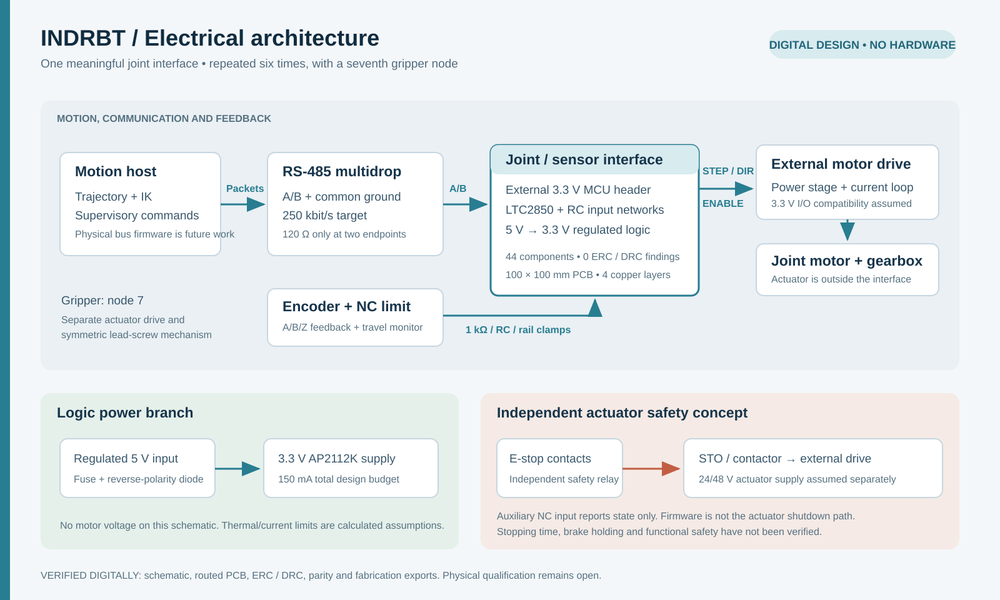
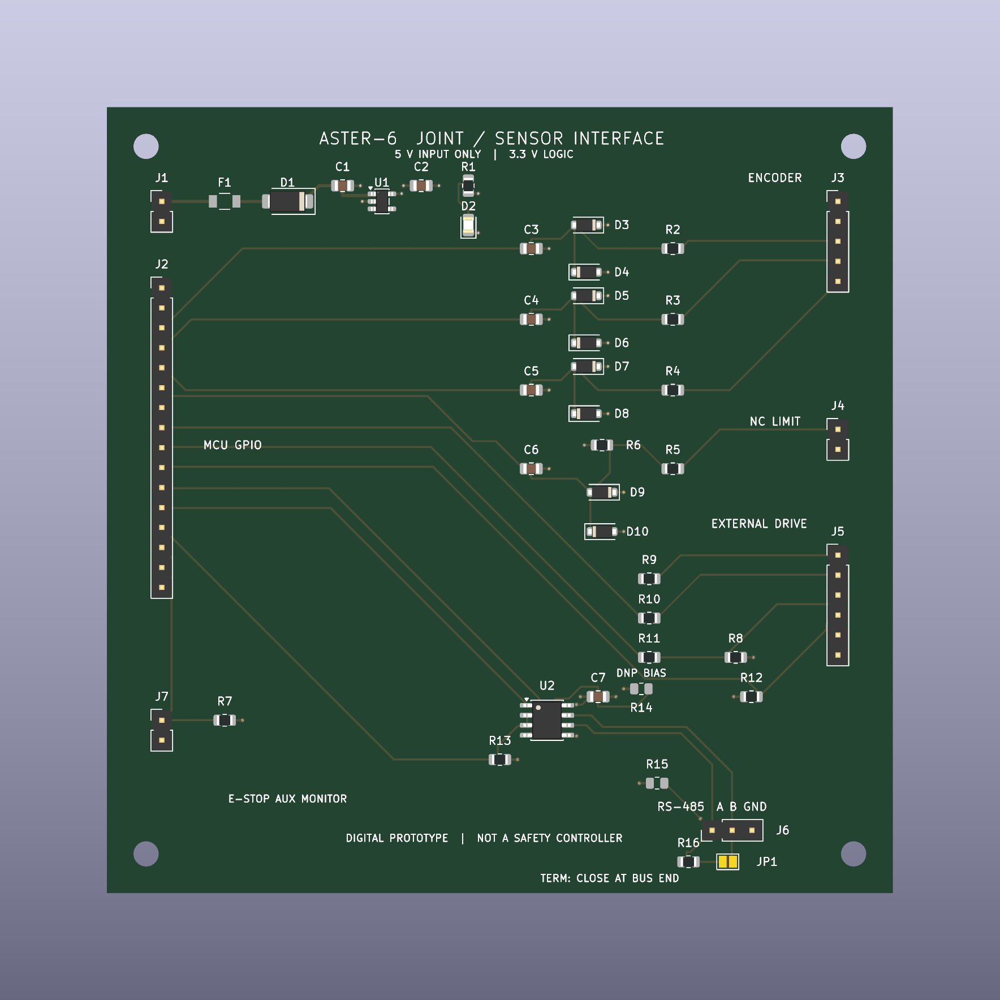

# Electrical architecture, schematic and routed PCB

This is a digital design for one ASTER-6 joint/sensor interface. It connects an external 3.3 V controller to an encoder, a normally closed limit switch, a separate motor drive and an RS-485 bus. The same architecture could be repeated for six joints and a gripper node. It contains no motor power stage, embedded firmware, built hardware or certified safety function.



New to schematics? Start with the [component guide](electronics_components.md). It explains reference letters, circuit blocks, default population and how to move between the BOM, schematic and board.

## Scope and evidence

| Item | Status and evidence |
|---|---|
| Native KiCad schematic | **VERIFIED DIGITALLY**: `electronics/joint_interface.kicad_sch`, generated from real stock KiCad symbols and real pin/wire connectivity |
| Electrical rules | **VERIFIED DIGITALLY**: KiCad **10.0.6**, default ERC rules, all report severities, **0 violations** in `electronics/erc_report.json` |
| Connectivity | **VERIFIED DIGITALLY**: **44 components, 28 connected nets, 118 pin assignments and 22 independent topology checks** in `electronics/net_verification.json` |
| Footprint references | **VERIFIED DIGITALLY**: **43 stock assignments plus one project-local F1 land pattern**; all 44 exist and match the symbol wildcards. F1's library and board copper dimensions match the manufacturer nominal drawing |
| BOM | [BOM CSV](../electronics/bom.csv) and [component guide](electronics_components.md); exact F1 part selected, with other ordering suffixes and passive purchasing choices still open |
| Readable schematic | Native CLI exports in `electronics/exports/joint_interface.pdf` and `.svg`, visually inspected after generation |
| Routed PCB | **VERIFIED DIGITALLY**: `electronics/joint_interface.kicad_pcb`; 100 × 100 mm, four copper layers, 44 schematic footprints plus four mechanical mounting holes, 265 track segments and 32 vias |
| PCB DRC / parity | **VERIFIED DIGITALLY**: **0 errors, 0 warnings, 0 unconnected items and 0 schematic parity issues**; `electronics/pcb_drc_report.json` and `electronics/pcb_verification.json` |
| Fabrication exports | Ten native Gerber layers, separate PTH/NPTH Excellon files, drill maps/report, assembly positions and IPC-D-356 netlist; hash-bound in `electronics/pcb_verification.json` |
| Electrical measurements | **NONE**. Timing, thermal, EMC, ESD and noise performance remain unverified |

The `.kicad_pro` retains KiCad factory ERC severities and contains explicit PCB fabrication constraints. Native saves serialize the default rule maps. No ERC/DRC exclusions or custom severity overrides were introduced to force a pass. The four `ignored_checks` entries come from KiCad 10's factory severity settings: each is assigned `RPT_SEVERITY_IGNORE` in the [KiCad 10 ERC settings source](https://github.com/KiCad/kicad-source-mirror/blob/10.0/eeschema/erc/erc_settings.cpp#L95). `--severity-all` reports every severity of the **enabled rules**; it does not enable ignored rules. The zero-violation claim is scoped accordingly.

| Factory-disabled rule | Applicability and remaining scope |
|---|---|
| `single_global_label` | This single-sheet design uses local labels, so no global-label singleton is being hidden |
| `four_way_junction` | Generated wires are short two-endpoint connections to labels, with no four-way junctions |
| `simulation_model_issue` | This schematic does not run SPICE; the robot control simulation is separate Python software |
| `footprint_filter` | This native ERC rule is disabled by the factory. Independent parsing checks all 44 footprint wildcard assignments without exceptions, and checks F1's actual land dimensions. Other stock patterns were reviewed for package/pin compatibility; manufacturing-process acceptance remains open |

The initial run found off-grid placements and a stock inherited-symbol mismatch. Placements were snapped to 1.27 mm, the RS-485 part was changed to a directly defined stock symbol, and ERC was rerun successfully.

## Power and component choices

J1 accepts an **ASSUMED** regulated 5.0 V ±5% source. F1 is the selected **Bourns MF-NSMF025X-2** resettable fuse, followed by an SS14 reverse-polarity diode. The protected rail feeds U1, an AP2112K-3.3 regulator, with 10 µF input and 4.7 µF output ceramic capacitors. The regulator requires a minimum effective output capacitance of 1 µF; select X7R/X5R components with DC-bias margin. J2 and J3 share a **TARGET** total 3.3 V load budget of 150 mA. This budget includes the external controller, encoder, RS-485 driver and status LED; it is not a measured current. The AP2112 pinout and capacitor requirement were checked against the [Diodes Incorporated datasheet](https://www.diodes.com/assets/Datasheets/AP2112.pdf).

At the upper input bound, neglecting upstream fuse/diode drop and including the configured regulator quiescent allowance gives this conditional dissipation estimate:

`P = (5.25 − 3.3) × 0.15 + 5.25 × 0.00008 = 0.29292 W`.

With the datasheet's 184 °C/W package estimate and an **ASSUMED** 40 °C ambient, the conditional junction estimate is **93.90 °C**. The 80 µA reference quiescent allowance contributes 0.42 mW of heat even with no external load. These calculations use nominal output voltage and reference datasheet values; they do not form a complete temperature/tolerance bound or measure this PCB's copper, airflow, hot spots or usable continuous current. F1's 40 °C hold rating is 230 mA. Including the same regulator quiescent allowance gives a 150.08 mA input budget, leaving a calculated 79.92 mA hold-current margin at that ambient. This does not establish startup or fault-trip behaviour.

Using F1's 2.3 Ω post-reflow resistance limit at 23 °C gives a calculated 0.345 V drop and 51.8 mW dissipation at that budget. At the low 4.75 V source bound, subtracting this drop and the SS14's 0.50 V test-condition forward-drop limit gives a conditional regulator input of **3.905 V**. These temperature-specific reference values are not a cold/hot operating guarantee. The [saved calculations](../electronics/interface_calculations.json) retain the assumptions and limitations. There is no input overvoltage limiter, so this interface must not receive the proposed 24/48 V drive supply.

D1 uses the SMA stock footprint, consistent with the [Vishay SS14 family](https://www.vishay.com/docs/88746/ss12.pdf). Input clamps D3–D10 use SOD-123F footprints, consistent with the [Nexperia BAT54H datasheet](https://assets.nexperia.com/documents/data-sheet/BAT54H.pdf). Stock footprint existence is checked automatically; exact assembly and fabrication choices remain open.

## Connector contract

| Connector | Pins in numeric order | Electrical contract |
|---|---|---|
| J1, 2 pins | 5V_IN, GND | Regulated input; 5.0 V ±5% |
| J2, 16 pins | 3V3, GND, ENC_A, ENC_B, ENC_Z, LIMIT_N, STEP_CMD, DIR_CMD, ENABLE_CMD, DRIVE_FAULT_N, UART_TX, UART_RX, RS485_DIR, ESTOP_MON_N, GND, GND | External controller; 3.3 V GPIO only; board 3V3 is a supply output |
| J3, 5 pins | 3V3, GND, ENC_A_RAW, ENC_B_RAW, ENC_Z_RAW | 3.3 V push-pull quadrature encoder, short cable; open-collector use requires source-side pull-ups |
| J4, 2 pins | LIMIT_RAW, GND | Normally closed dry contact; closed at allowed travel, open at limit or broken wire |
| J5, 6 pins | STEP_DRV, DIR_DRV, ENABLE_DRV, DRIVE_FAULT_N, GND, GND | Drive must accept 3.3 V STEP/DIR and active-high ENABLE; FAULT must be 3.3 V open drain |
| J6, 3 pins | RS485_A, RS485_B, GND | Non-isolated A/B bus with shared ground; pin naming follows U2's datasheet |
| J7, 2 pins | ESTOP_MON_N, GND | Auxiliary normally closed E-stop contact for monitoring inside the enclosure |

For J2, ENC_A/B/Z, LIMIT_N, DRIVE_FAULT_N, UART_RX and ESTOP_MON_N are inputs to the controller; STEP_CMD, DIR_CMD, ENABLE_CMD, UART_TX and RS485_DIR are outputs. External GPIO must provide Schmitt input hysteresis for the filtered encoder and limit signals. Sequence power to avoid back-powering GPIO or the 3.3 V rail. J7 is an unprotected auxiliary dry-contact monitor, not a field sensor input.

## Input conditioning and command behavior

Each encoder channel has a 1 kΩ series resistor, a 100 pF shunt capacitor and correctly oriented upper/lower Schottky clamps. Nominal `RC = 100 ns`; cable, diode and controller capacitance add to this value. The circuit is a short-cable educational interface, not a validated industrial encoder receiver. The clamps limit modest input excursions; they do not establish IEC ESD immunity, 5 V compatibility or tolerance to continuous faults. High-energy inputs can inject current into the 3.3 V rail.

The limit input uses 1 kΩ series resistance, 10 kΩ pull-up, 100 nF capacitance and two rail clamps. With the normally closed switch grounded, the nominal divider voltage is **0.30 V**. The calculated release time constant is **1.00 ms**; closure is **90.91 µs** because the two resistors are then in parallel. Firmware must debounce and interpret open/broken-wire as a fault. This cannot detect every possible fault, including a short to ground.

Drive STEP, DIR and ENABLE commands each pass through 330 Ω. R8 pulls ENABLE_DRV low while the controller is disconnected or high impedance. R12 pulls an open-drain fault line high. The selected drive must match these polarity and voltage assumptions. Motor phase wires, current sensing, brake control and power switching belong to an external drive; no such hardware is implemented here.

## RS-485 network

U2 is an LTC2850IS8 half-duplex 3.3 V transceiver. Its `/RE` and `DE` are tied to RS485_DIR: low selects receive, high selects transmit. A 10 kΩ pull-down selects receive by default. C7 is its 100 nF local decoupling capacitor. Its supply, pinout, internal failsafe and ±200 mV receiver threshold were checked against the [Analog Devices datasheet](https://www.analog.com/media/en/technical-documentation/data-sheets/285012fe.pdf). A terminated bus draws substantially more current than an unloaded receiver: the datasheet's 2 V differential example across two 120 Ω terminators consumes about 33 mA. Account for that load within the shared 150 mA budget when selecting the external controller and encoder.

JP1 closes a 120 Ω termination path only on the two physical bus endpoints. R14/R15 are **DNP by default** because U2 already provides receiver failsafe. If external bias is desired, populate the pair at exactly one bus node. The optional 330 Ω / 330 Ω pair gives **275 mV** nominal idle differential voltage with two 120 Ω terminators; the ideal worst case at 3.0 V and 1% resistor extremes is **245.45 mV**, above the 200 mV threshold. This calculation excludes cable loss, leakage and common-mode effects. An earlier 680 Ω choice was rejected during the design review because 3.3 V with two terminators would provide only 139 mV.

The bus target is **250 kbit/s**, with one master and seven nodes, short stubs and a common ground. Addressing, packet CRC, timeout handling and firmware are architectural proposals, not implemented electronics tests. Simulation presently runs entirely in Python. The routed PCB has a 3.562 mm explicit front-copper connection between U2 supply and C7, plus adjacent plane fanouts. Its paired front-copper bus paths are 28.961 mm and 31.418 mm, with a 2.457 mm length difference. These measured layout distances support the stated low-rate design intent; they do not prove timing, impedance or EMC performance. Protection, grounding and isolation still need review for an actual installation.

## Routed board, rules and fabrication evidence



The layout uses F.Cu for components and most signals, an In1.Cu ground plane, an In2.Cu 3.3 V plane and B.Cu for signal crossovers. The intended stackup is nominal 1.6 mm FR4 with 35 µm copper and ENIG finish; 0.20 mm outer dielectrics and a 1.04 mm core are design inputs, not a certified fabricator stackup. No controlled-impedance claim is made. Four nonplated 3.2 mm M3 mounting holes have centres 5 mm from the board edges. Connectors face the perimeter, the regulator sits between its input/output capacitors, filtered inputs are grouped near their sensor connector, and the transceiver, bias options and termination sit beside the bus connector. Power-plane fanouts and a continuous internal ground reference avoid long shared ground traces.

The conservative signal routing uses 0.25 mm traces; the protected 5 V path uses 0.40 mm. Through vias are 0.60 mm diameter with 0.30 mm drill. These are low-current logic paths, not motor-power conductors. The native project and `joint_interface.kicad_dru` enforce 0.20 mm minimum copper clearance, 0.20 mm minimum track width, 0.50 mm copper-to-edge clearance, 0.15 mm minimum via annular ring, and 0.25 mm unrelated drilled-hole/copper spacing. Silkscreen clearance is 0.15 mm; text is at least 0.8 mm high with a 0.12 mm minimum stroke. The exporter does not hide silkscreen violations with mask subtraction.

Actual native DRC includes `--all-track-errors --schematic-parity --severity-all --exit-code-violations --refill-zones --save-board`. The final command returns exit 0 with zero violations, zero unconnected items and zero parity issues. Independent parsing compares all **119 physical pad-net assignments**, including the deliberately isolated U1 NC pad, against the native XML netlist; **118** are the connected contract pins. It also verifies the closed outline, filled planes, values, footprint IDs and schematic UUID links. The four mounting footprints are explicitly `board_only` mechanical additions and are excluded from the BOM/assembly-position output. No extra electronic footprint is omitted from parity review.

KiCad 10 disables five DRC checks by default, as shown in its [board settings constructor](https://github.com/KiCad/kicad-source-mirror/blob/10.0/pcbnew/board_design_settings.cpp#L150). The runner compares the serialized severity map with the factory WARNING/IGNORE sets; **no non-default severity overrides or exclusions** are permitted.

| Factory-disabled DRC rule | Explicit review and scope |
|---|---|
| `missing_courtyard` | All 48 footprints have courtyard geometry; courtyard overlaps remain enabled and pass |
| `track_not_centered_on_via` | Plane fanouts and layer transitions terminate at via centres; this factory rule itself is not enabled |
| `tuning_profile_track_geometries` | No tuning profiles are used; A/B path lengths are measured independently |
| `footprint_type_mismatch` | Ordinary SMD/THT components use their stock pad technology; the solder jumper is bare copper and mounting holes are nonplated board features |
| `footprint_filters_mismatch` | Independent parsing confirms all 44 schematic assignments match their stock symbol wildcards, with no exception. Matching names alone cannot prove a suitable land pattern |

F1 uses the selected MF-NSMF025X-2 and the project-local [PTC footprint](../electronics/ASTER_Interface.pretty/PTC_Bourns_MF-NSMF025X_1206.kicad_mod). The [Bourns drawing](https://www.bourns.com/docs/product-datasheets/mf-nsmf.pdf), page 8, specifies nominal **1.0 × 1.6 mm copper pads with a 2.0 mm inner gap**. Pad centres are ±1.5 mm; the courtyard covers the maximum body and pads with a 0.25 mm margin. Both the local library and saved board pad sizes/positions are checked against [fuse_selection.json](../electronics/fuse_selection.json), and the native IPC-D-356 export reflects the corrected pad sizes. Copper, mask, paste, fabrication and courtyard geometry are present. A manufacturer-specific 3D fuse body is not included; the rendered view shows its lands.

The generic stock land patterns for the other devices agree with their package families and pin counts, but are not asserted to reproduce every manufacturer's suggested soldering pattern exactly. Passive ordering choices, effective capacitance, solder process, fuse inrush/trip behaviour and assembly acceptance remain physical-build review items.

The [fabrication ZIP](../electronics/fabrication/joint_interface_fabrication.zip) contains ten separate Gerber layers, separate plated/nonplated Excellon drill files, drill maps/report, assembly positions, IPC-D-356 netlist and BOM. The position file contains 41 component bodies. Optional R14/R15 bias resistors are DNP and are excluded; JP1 is a bare copper solder jumper with no body to place, and the four mounting footprints are mechanical exclusions. Native [six-page layer PDF](../electronics/exports/pcb_layers.pdf), individual layer SVGs and [3D board view](../electronics/exports/pcb_3d.png) were generated and visually reviewed. `pcb_verification.json` binds board, schematic, project constraints, netlist, pin contract, routing manifest, native DRC and exported files with SHA-256 hashes. This proves file consistency and executed digital checks; it does not substitute for manufacturer CAM approval, production testing, EMC/ESD tests or measured thermal performance.

## Emergency stop and power distribution

The system concept separates a 5 V logic branch from an **ASSUMED** external 24/48 V actuator branch. A separate safety relay and suitable drives would control STO and/or a power contactor. The E-stop auxiliary input merely reports contact state to the controller. A firmware decision or this input must never be the sole means of interrupting actuator torque. No safety integrity level, performance level, standards compliance, brake holding or stopping time is claimed or tested.

## Reproduce the evidence

Enter `06_Complete_Project_Source` from the organized repository root. With KiCad 10 installed, run:

```text
python electronics/run_checks.py --kicad-cli /path/to/kicad-cli
```

`KICAD_CLI` or PATH may supply the executable. The runner also discovers Windows installations through their registry entry. It exports the native netlist, normalizes source/library paths, executes ERC with violation-sensitive exit codes, verifies all pins plus 22 independent circuit statements, checks stock and local footprint assignments, recalculates electrical values from the BOM, and refreshes schematic PDF/SVG exports. It then runs PCB DRC with schematic parity, all report severities, all track errors and violation-sensitive exit codes, refills/saves the planes, audits physical board pad nets, and regenerates fabrication files, PCB layer views and native 3D images. If stock footprints are elsewhere, set `KICAD10_FOOTPRINT_DIR` or provide `--footprints`.

The assigned-footprint check resolves stock libraries and the portable `${KIPRJMOD}/ASTER_Interface.pretty` local library. Saved-evidence checks require no installed KiCad libraries. Standalone `verify_pcb.py` verifies the source hashes bound to the saved native DRC; a routing or design edit invalidates that evidence until a fresh native run. The native runner audits its newly generated report before replacing the old binding, so an expected stale manifest cannot block regeneration. To cross-check the exported BOM, populated positions, Gerber job, drills, ZIP and all source/export hashes, run:

```text
python electronics/review_electronics.py
```

It writes [final_electronics_review.json](../results/validation/final_electronics_review.json). This is an offline consistency audit of saved native results, not a replacement for a fresh ERC/DRC run after an edit.

To rebuild the schematic itself, use:

```text
python electronics/generate_interface.py --symbols /path/to/kicad/symbols
python electronics/run_checks.py --kicad-cli /path/to/kicad-cli
```

`KICAD10_SYMBOL_DIR` can provide the symbol directory. `electronics/verify_netlist.py` can inspect the saved exported netlist without KiCad, but that alone is an offline connectivity review rather than a fresh native ERC run. `electronics/electrical_assumptions.json` holds the explicit electrical assumptions; calculations are saved in `electronics/interface_calculations.json`.

To regenerate the routed PCB, use **KiCad's bundled Python** (the normal project Python need not contain `pcbnew`):

```text
/path/to/kicad/bin/python electronics/generate_pcb.py --footprints /path/to/kicad/footprints
python electronics/run_pcb_checks.py --kicad-cli /path/to/kicad-cli
```

The stock footprint directory can also come from `KICAD10_FOOTPRINT_DIR`; the generator discovers it relative to KiCad Python when possible. The board generator preserves the existing schematic contract. `generate_interface.py` preserves reviewed project settings when refreshing the schematic. `verify_pcb.py` provides an offline saved-evidence audit; a fresh native DRC run is provided by the runners. `--skip-pcb-render` (full runner) or `--skip-render` (PCB runner) skips only refreshing 3D images, while retaining native electrical/fabrication checks.

For a reviewed change to the local fuse land pattern, `generate_pcb.py --update-fuse` refreshes F1 while preserving existing routing. Rebuild the schematic and rerun the complete native checks/exports afterward; preserved tracks must still pass real connectivity and DRC.

ELEC-001 and ELEC-002 now have executed digital schematic and routed-board evidence within the documented low-voltage interface scope. No physical board was built, and these results are not product qualification or a hardware safety claim.

## Independent circuit review, 17 October 2026

The [saved-file circuit review](../results/validation/electronics_circuit_review.json)
checked the power path, conditioned inputs, drive commands, RS-485 topology and
fuse pads through native MCP tools. All 48 footprint pad contracts and 14 embedded
symbol pin contracts agreed with the installed libraries. This is documented
digital evidence on the exact saved design; it does not establish production
qualification or capture unsaved editor state.

Generic power-audit notices were assessed explicitly. Its universal 10 µF output
threshold is more restrictive than the selected regulator's minimum effective
capacitance; the nominal 4.7 µF part still requires DC-bias and transient selection
checks. The short pre-diode fuse/input rails feed no IC, while C1 bypasses the
regulator's protected input. Dedicated production test points are an optional
physical-debug improvement; headers and component lands are available in this
concept. These dispositions retain the notices and their scope. The native
ERC/DRC findings are recorded separately.
