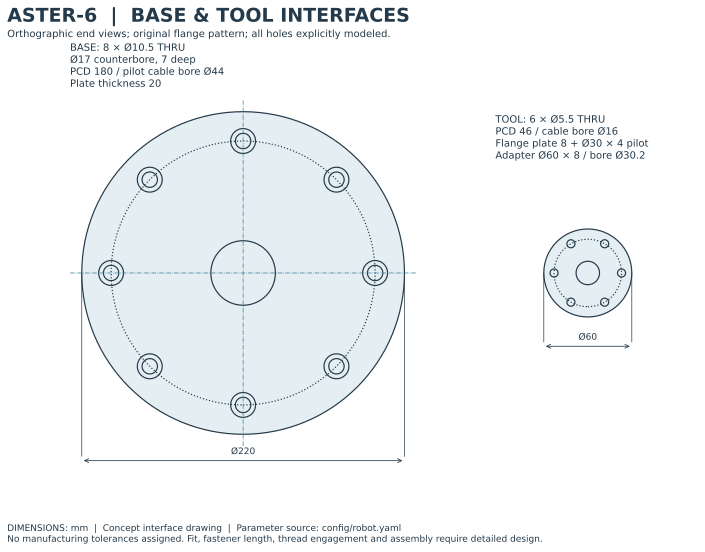
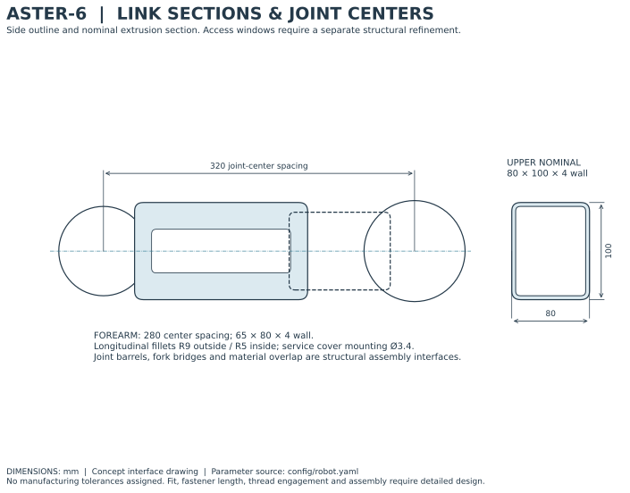
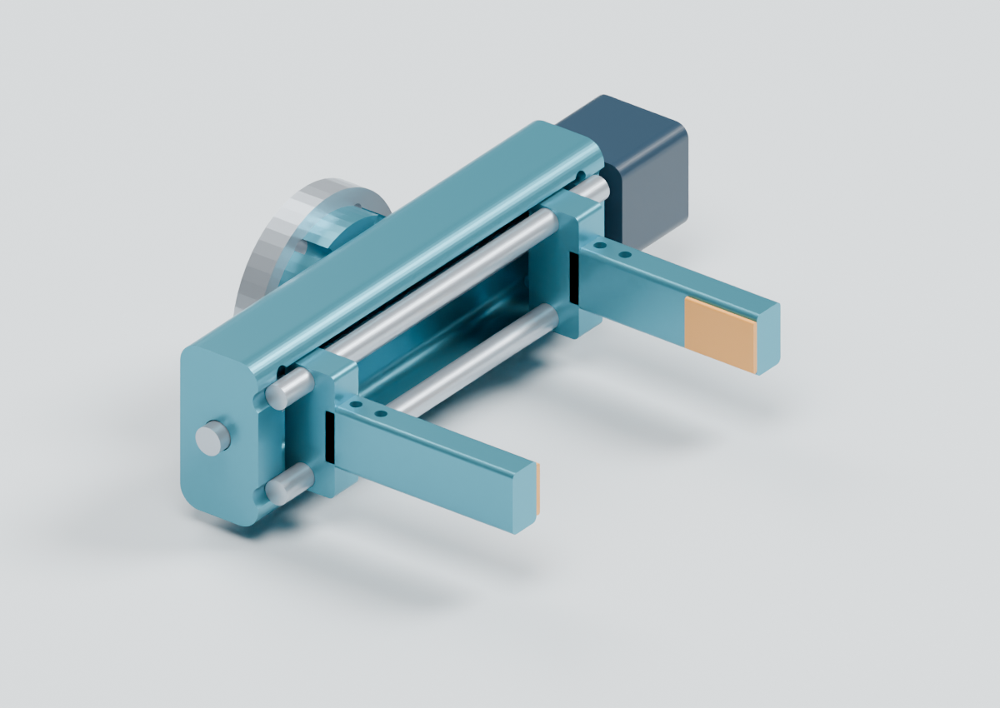
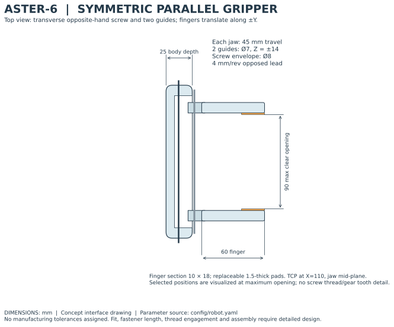
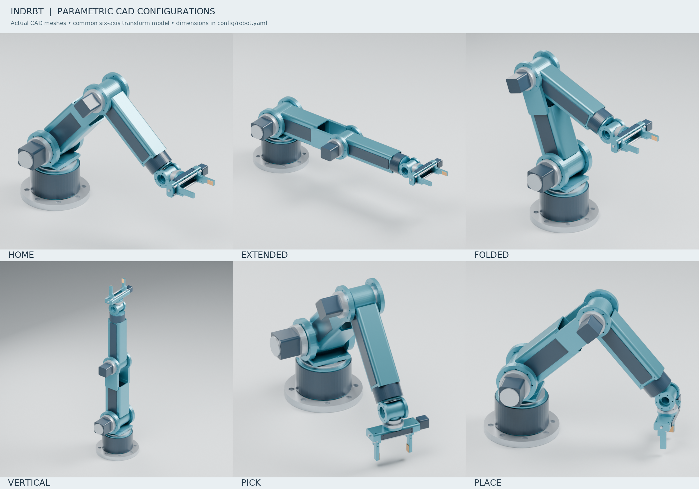

# Mechanical design tour

[Project home](../../README.md) · [CAD files](../cad/README.md) · [All 54 components](component_catalog.md) · [Detailed CAD method](04_cad.md)

ASTER-6 connects a six-axis arm to an interchangeable parallel gripper. The model has **54 solid components**, **six saved poses** and **90 mm of clear jaw opening**. These images come from the project's CAD geometry; the same part meshes drive the offline interactive viewer.

## Choose how to explore

| You want to inspect | View directly on GitHub | Download and open locally |
|---|---|---|
| The complete robot | [Assembly image](../cad/renders/hero.png) · [six poses](../cad/renders/poses.png) | [FreeCAD assembly](../cad/freecad/aster6_home.FCStd) · [home STEP](../cad/exports/STEP/assembly_home.step) |
| The gripping mechanism | [Gripper close-up](../cad/renders/gripper.png) · [dimensioned layout](drawings/03_gripper_layout.svg) | [Gripper body STEP](../cad/exports/STEP/gripper_pocketed_body.step) · [part catalog](component_catalog.md#find-an-individual-component) |
| Dimensions and interfaces | [Base and flange](drawings/01_base_tool_interfaces.svg) · [link sections](drawings/02_link_sections.svg) | [Three-page drawing PDF](drawings/engineering_interfaces.pdf) |
| Joint motion or one isolated part | [Six-pose sheet](../cad/renders/poses.png) | [Interactive viewer](../simulations/aster6_twin.html): pose selector, joint controls and component selector |

GitHub shows the HTML viewer's source. Download the complete project or clone the repository, then use [OPEN_3D_VIEWER.cmd](../../OPEN_3D_VIEWER.cmd) or [OPEN_FREECAD_MODEL.cmd](../../OPEN_FREECAD_MODEL.cmd) on Windows. The launchers open the appropriate application. On other systems, open the downloaded viewer HTML in a browser or the native model in FreeCAD.

## Follow the mechanical chain

The fixed mounting plate and hollow riser support a rotating turret. Shoulder and elbow joints position the two hollow arm links; three wrist rotations orient the tool. The joint-axis sequence is **Z–Y–Y–X–Y–X**. The configured upper-arm and forearm centre spacings are 320 and 280 mm.

| Base and tool interfaces | Arm structure |
|---|---|
|  |  |
| The Ø220 base plate has eight mounting holes with 7 mm counterbores. A hollow route passes through the base and joint envelopes. | Hollow link sections, external elbow cheeks and removable service covers provide a visible structural layout and access route. The covers are not assumed to restore the cut sections' stiffness. |

The wrist finishes at a six-hole tool flange. Its **Ø30 × 4 mm locating spigot** enters the adapter's Ø30.2 bore; the **Ø60 adapter** retains 4.25 mm of material outside each bolt hole. Matching bolt passages continue through the gripper rear wall. The rear cable opening reaches the gripper pocket. These details connect the tool to the arm geometrically; final fasteners, tolerance stacks and cable bends remain concept work.

## How the gripper works

An opposite-hand screw concept moves two carriages equally in opposite directions along two steel guide rods. Each jaw travels 45 mm, producing **0–90 mm clearance between the contact pads**. The fingers extend along tool X; opening and closing occurs along tool ±Y. The configured screw lead is 4 mm per revolution.

The carriages include connected nut bosses and finger support tabs. The two finger fastener holes align with the tabs, replaceable pads define the contact surfaces, and a top hatch provides access without intersecting the adapter. The modeled screw and smooth nut bores locate the drive concept; they do not represent engaged threads, preload or simulated contact force. The [mechanical calculations](03_mechanical_analysis.md) explain the separate grip-force and screw-torque model.

## Compare six configurations

| Home | Extended | Folded | Vertical | Pick | Place |
|---|---|---|---|---|---|
| [STEP](../cad/exports/STEP/assembly_home.step) | [STEP](../cad/exports/STEP/assembly_extended.step) | [STEP](../cad/exports/STEP/assembly_folded.step) | [STEP](../cad/exports/STEP/assembly_vertical.step) | [STEP](../cad/exports/STEP/assembly_pick.step) | [STEP](../cad/exports/STEP/assembly_place.step) |

Individual STEP/STL parts use their **local assembly-group frames** and millimetres. Opening every part at a common origin will not assemble the robot. Use a complete pose file, the FreeCAD home assembly or the viewer; the [kinematics guide](02_kinematics.md) defines the transforms.

## Where the design lives

[robot.yaml](../config/robot.yaml) supplies the SI dimensions. [Build123d geometry](../cad/build123d/geometry.py) constructs the solids, and [assembly.py](../cad/build123d/assembly.py) places them using the robot's joint frames. This Python source is the reproducible parametric design. The FreeCAD file contains the exported home-pose solids with descriptive labels and material/group metadata; it is an inspection assembly rather than a sketch-based feature tree.

The [CAD audit](../results/validation/final_cad_review.json) checks exported solids, native visibility, interfaces, five jaw openings and source bindings. Named-pose and sampled-task clearance evidence accompanies it. These checks support the digital model; they do not establish physical payload, repeatability or production readiness. For reproduction and the exact validation scope, continue to the [CAD method](04_cad.md) and [source CAD guide](../cad/README.md).
