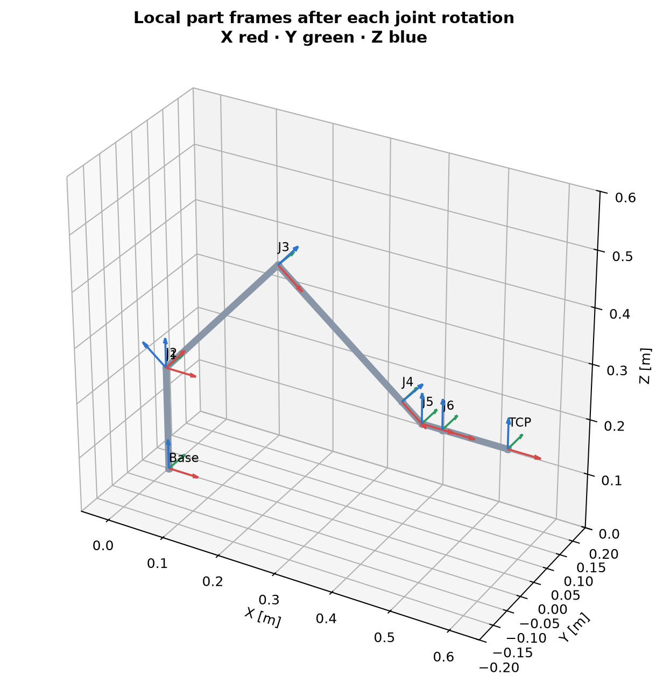
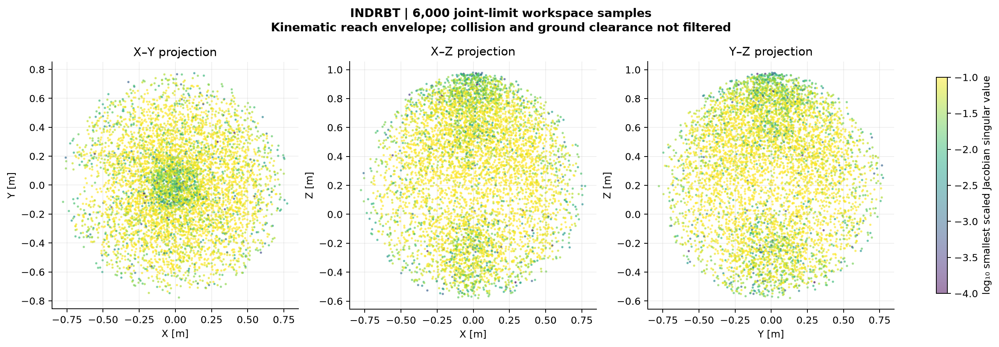
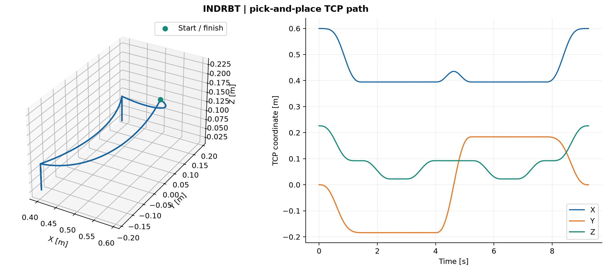
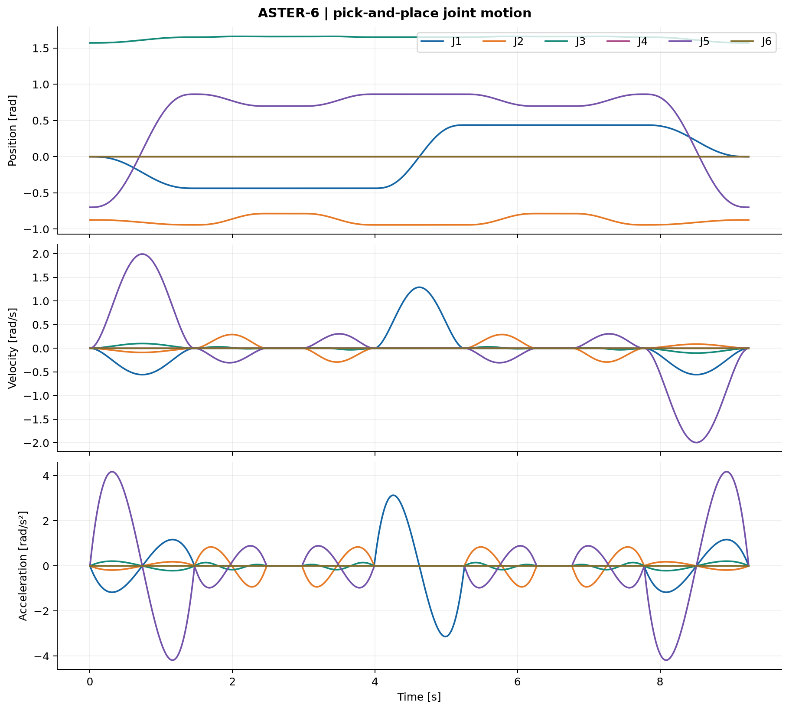
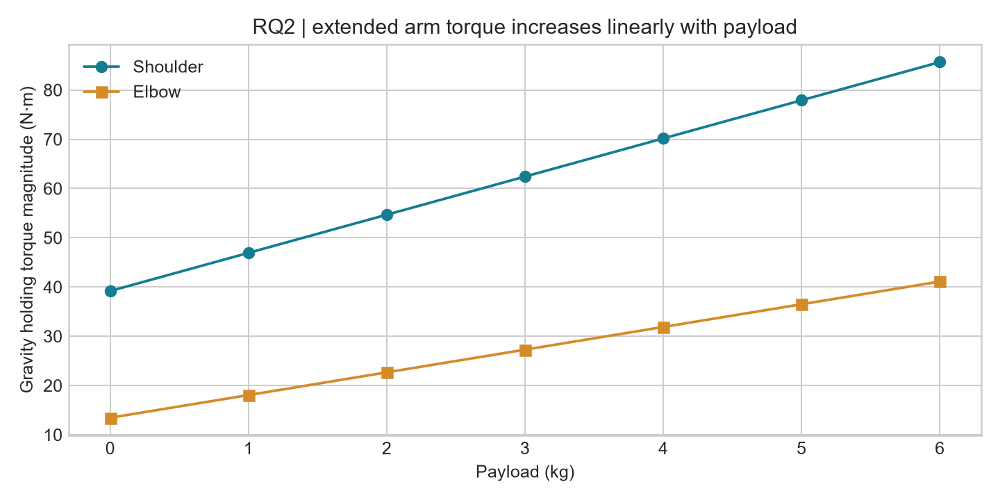
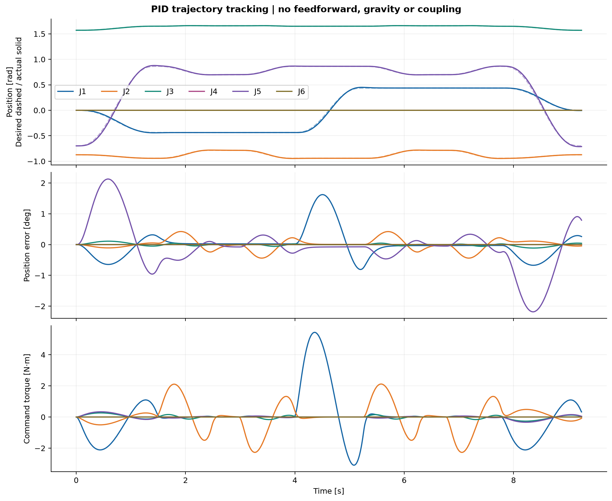

# How ASTER-6 works

**[Read this walkthrough in the browser showcase](https://aster-six-engineering-showcase.warmkiwi64.chatgpt.site/#theory)** — no CAD application or GitHub access required.

[Documentation home](README.md) · [Project purpose](project_alignment.md) · [Full theory guide](theory_guide.md)

ASTER-6 asks one connected question: **can an original six-axis arm move a tool through a useful task, support an assumed load and follow commands in a defined digital model?** Follow the same pick-and-place demonstration from geometry to evidence below. No physical robot was built.

**Reading key:** TARGET is a desired specification; ASSUMED is a model input; CALCULATED and SIMULATED are model outputs; VERIFIED DIGITALLY identifies an executed check. The 4 kg payload and ±0.1 mm repeatability remain targets.

## 1. Geometry gives the tool somewhere to go

Six revolute joints turn about local **Z–Y–Y–X–Y–X** axes. The shoulder and elbow position the wrist; the three wrist joints change tool orientation. The upper arm is 320 mm, the forearm 280 mm and the wrist/tool offsets total 190 mm. Their sum gives a **790 mm shoulder-centred radial reach bound**. The shoulder is 190 mm above the base plane, giving a 980 mm TCP height in the straight-up pose. TCP means tool centre point.



**Read the figure:** each red/green/blue triad shows a local X/Y/Z frame after a joint rotation. These same frames place the CAD parts. It establishes the coordinate convention; it does not establish structural stiffness or collision clearance.

Geometry, limits and assumptions live in the [central SI configuration](../config/robot.yaml). The [CAD chapter](04_cad.md), [component catalog](component_catalog.md) and [drawings](drawings/engineering_interfaces.pdf) connect the dimensions to the modeled interfaces.

## 2. Kinematics turns geometry into a tool pose

**Forward kinematics (FK)** answers “where is the tool for these six angles?” A transform carries both position and orientation. Multiplying joint rotations and link translations follows the arm from base to tool:

```text
T = Tz(h) Rz(q1) Ry(q2) Tx(L1) Ry(q3) Tx(L2)
    Rx(q4) Tx(lr) Ry(q5) Tx(lp) Rx(q6) Tx(lt)
```

`Tz`/`Tx` are translations; `Rx`/`Ry`/`Rz` are rotations. Distances use metres and angles use radians internally. At zero angles, FK must return `(0.790, 0, 0.190)` metres with identity orientation: a useful hand check.

**Inverse kinematics (IK)** works backward from a requested tool pose. ASTER-6 uses bounded numerical least squares and deterministic restart seeds, then checks the returned pose. The retained 60 perturbed-seed trials have a maximum position residual of **2.70 × 10⁻¹¹ m**. That checks numerical reconstruction; it is unrelated to physical repeatability. A failed local search does not prove that every branch is unreachable.

The **Jacobian** relates small joint motions to tool velocity: `[linear velocity; angular velocity] = J(q) × joint velocity`. Near a singular pose, some tool motions become difficult or impossible without large joint speeds. MOVE L therefore rejects sampled poses whose smallest scaled singular value is at or below 0.001; this is a numerical guard, not a safety threshold.



**Read the plot:** the points show where FK places the TCP for 6,000 seeded joint samples; colour indicates Jacobian conditioning. The envelope includes below-floor and self-colliding possibilities. Its convex hull fills holes and is not a certified reachable or safe volume.

Continue with [frames, IK and Jacobian derivations](02_kinematics.md), [implementation](../src/robotarm/kinematics/model.py) and [numerical checks](../results/validation/numerical_validation.json).

## 3. Give the tool a useful job

The task starts at home, approaches an object, descends, closes the gripper, lifts, transfers, lowers, releases and returns home. **MOVE J** interpolates joint angles for transfers. **MOVE L** follows an approximately straight tool path using successive IK solutions for approach and retreat.



**Read the plot:** vertical approaches appear where X/Y stay constant while Z changes; the transfer curves because it uses joint-space motion. Dwell intervals allow the scripted gripper events. This shows the requested geometric path, not contact or payload dynamics.



**Read the plot:** the derivatives show what each joint must do to follow that path. Quintic MOVE J segments have zero endpoint speed and acceleration. MOVE L derivatives use finite differences and time scaling; their limits are checked at samples. Continuous collision freedom and between-sample derivative bounds are not certified.

The simulated task takes **9.24398 s**, records **1,041 samples** and travels **1.32360 m**. The largest speed and acceleration fractions are **95.17%** and **99.80%** of the assumed limits. The object attaches to the tool through an ideal kinematic constraint, rather than friction/contact physics.

See the [recorded metrics and phase timings](../results/trajectories/pick_place_metrics.json), [planner](../src/robotarm/planning/trajectories.py), [task sequence](../src/robotarm/simulation/tasks.py) and [FK animation](../results/trajectories/pick_place_fk.gif). [Operate the interactive CAD twin online](https://aster-six-engineering-showcase.warmkiwi64.chatgpt.site/#robot) with no download. The [source setup and run instructions](../README.md#run) describe optional local reproduction and offline use.

## 4. Check loads before choosing a drive

A long reach increases leverage. Using ASSUMED link masses and midpoint centres of mass, the 4 kg load at full extension gives **70.165 N·m shoulder** and **31.880 N·m elbow** static holding-torque magnitudes. The load model totals 23.65 kg; the separately calculated 19.908 kg CAD envelope sum uses simplified component interiors and overlaps, so the two quantities serve different purposes.



**Read the plot:** each added kilogram increases torque in proportion to its lever arm. It is a sensitivity study for the assumed mass/geometry model, not a measured payload rating.

The conceptual drive calculation adds diagonal inertia and damping allowances, then applies safety factor 2:

```text
output torque = 2 × (gravity bound + sizing inertia × acceleration limit
                    + damping × velocity limit)
motor torque  = output torque / (gear ratio × assumed efficiency)
```

The shoulder result is **165.425 N·m output**, or **1.969 N·m motor torque** with a 120:1 ratio and 0.70 efficiency. Sizing inertia uses the larger of the educational plant inertia and the corresponding point-mass inertia bound. Coupled dynamics, reflected drive inertia and continuous-duty heating remain outside this calculation.

An ideal beam model estimates **0.10408 mm serial TCP deflection**. Holes, contacts, bearings and gearbox compliance are omitted; this does not establish full assembly stiffness or ±0.1 mm repeatability. Follow the [mechanical chapter](03_mechanical_analysis.md), [torque source](../analysis/joint_torque_analysis.py), [beam source](../analysis/structural_analysis.py) and [load results](../results/mechanical/joint_torque.json).

## 5. Make the gripper calculation match its mechanism

An opposed-hand lead screw moves two guided jaws symmetrically. A **90 mm opening** requires **45 mm travel per jaw**. Each nut travels 4 mm per revolution, so the full gap changes by 8 mm and the full stroke needs **11.25 revolutions**.

For the **200 N total normal-force target** (100 N per jaw), work balance gives `torque = total normal force × lead / (2π × efficiency)`. At assumed efficiency 0.35, the required screw torque is **0.363783 N·m**. With assumed friction coefficient 0.5 and safety factor 2, the ideal static friction-only capacity is **5.099 kg**. It is not a physical load rating; acceleration, guide friction and object contact are omitted.

Explore the [gripper render](../cad/renders/gripper.png), [mechanism and finger-stiffness discussion](03_mechanical_analysis.md#gripper-mechanism), [gripper code](../src/robotarm/gripper/model.py) and [finger-length study](../results/research/finger_length.png). Screw threads and preload remain conceptual in the CAD.

## 6. Test how a simplified joint follows commands

The planner supplies desired angles. A PID controller uses position error, accumulated error and velocity error to command torque. Torque saturation and conditional integration limit the command and reduce integrator windup. Each virtual joint follows `I × acceleration + b × velocity = commanded torque`.



**Read the plot:** dashed and solid curves compare desired and simulated angles; the middle panel exposes tracking error, and the bottom panel shows the torque command. The overall task tracking RMSE is **0.006383 rad** across all joint samples. It is an aggregate angular metric, not TCP accuracy. Gravity, coupling, backlash, noise and drive delay are absent from these independent-axis plants.

Read the [architecture](architecture.md), [PID source](../src/robotarm/control/pid.py), [step response](../results/control/pid_step_response.png), [control metrics](../results/control/metrics.json) and [gain-sensitivity study](../results/research/pid_tuning.png).

## 7. Connect the model to meaningful conceptual electronics

The KiCad design covers a **low-voltage joint/sensor interface**: an external 3.3 V controller, encoder and limit inputs, external-drive commands, regulated power and RS-485 communication. It is a concrete subsection of the proposed controller architecture; the Python simulation does not run through the PCB.


**Read the image:** connector placement, power distribution and routing are inspectable against the schematic and manufacturing exports. The board has 48 footprints and four copper layers. Retained native checks report **zero ERC violations and zero DRC errors, warnings or unconnected items** under the documented enabled rules. These checks do not establish EMC, thermal, functional-safety or hardware performance.

Follow the [electronics chapter](05_electronics.md), [component/BOM guide](electronics_components.md), [schematic PDF](../electronics/exports/joint_interface.pdf), [PCB layers PDF](../electronics/exports/pcb_layers.pdf) and [native check evidence](../electronics/pcb_verification.json).

## Continue from the question that interests you

| Question | Next stop |
|---|---|
| How are the equations derived? | [Full theory guide](theory_guide.md) and [kinematics](02_kinematics.md) |
| Why these engineering choices? | [Requirements](01_requirements.md), [decisions](design_decisions.md) and [journal](project_journal.md) |
| What changed when parameters varied? | [Five actual research sweeps](../results/research/experiments.json) and [their interpretation](engineering_report.md#16-results-and-research-questions) |
| What was actually checked? | [Validation matrix](validation_matrix.md), [executed report](../results/validation/validation_report.md) and [scope audit](digital_scope_audit.md) |
| How do I reproduce the demonstration? | [Setup and run commands](../README.md#run), then [CAD reproduction](04_cad.md#refresh-native-cad-evidence) for native outputs |
