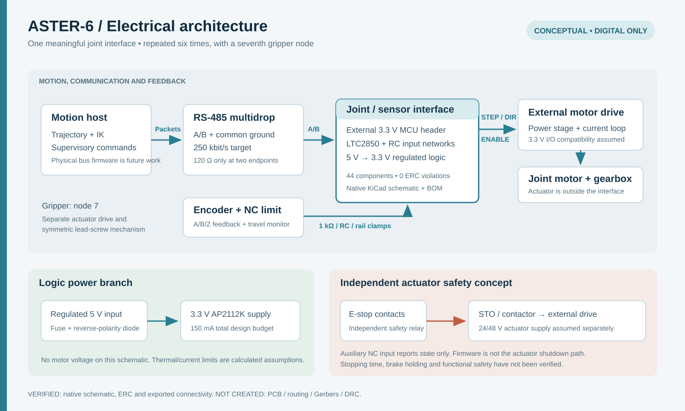

# Conceptual electrical architecture and KiCad interface

This is a digital design for one ASTER-6 joint/sensor interface. It connects an external 3.3 V controller to an encoder, a normally closed limit switch, a separate motor drive and an RS-485 bus. The same architecture could be repeated for six joints and a gripper node. It contains no motor power stage, embedded firmware, built hardware or certified safety function.



## Scope and evidence

| Item | Status and evidence |
|---|---|
| Native KiCad schematic | **VERIFIED DIGITALLY**: `electronics/joint_interface.kicad_sch`, generated from real stock KiCad symbols and real pin/wire connectivity |
| Electrical rules | **VERIFIED DIGITALLY**: KiCad **10.0.6**, default ERC rules, all report severities, **0 violations** in `electronics/erc_report.json` |
| Connectivity | **VERIFIED DIGITALLY**: **44 components, 28 connected nets, 118 pin assignments and 22 independent topology checks** in `electronics/net_verification.json` |
| Footprint references | **VERIFIED DIGITALLY**: all **44** assigned stock footprint files were found; this is not a land-pattern manufacturing review |
| BOM | `electronics/bom.csv`; values, footprints, datasheets and population options; manufacturer ordering suffixes and passive part selections remain conceptual |
| Readable schematic | Native CLI exports in `electronics/exports/joint_interface.pdf` and `.svg`, visually inspected after generation |
| PCB / DRC | **NOT CREATED / NOT APPLICABLE**. There is no routed board, Gerber set or DRC pass claim |
| Electrical measurements | **NONE**. Timing, thermal, EMC, ESD and noise performance remain unverified |

The `.kicad_pro` contains `{}` and uses default rules. No ERC exclusions or ignored-rule overrides were introduced to force a pass. The four `ignored_checks` entries come from KiCad 10's factory severity settings: each is assigned `RPT_SEVERITY_IGNORE` in the [KiCad 10 ERC settings source](https://github.com/KiCad/kicad-source-mirror/blob/10.0/eeschema/erc/erc_settings.cpp#L95). `--severity-all` reports every severity of the **enabled rules**; it does not enable ignored rules. The zero-violation claim is scoped accordingly.

| Factory-disabled rule | Applicability and remaining scope |
|---|---|
| `single_global_label` | This single-sheet design uses local labels, so no global-label singleton is being hidden |
| `four_way_junction` | Generated wires are short two-endpoint connections to labels, with no four-way junctions |
| `simulation_model_issue` | This schematic does not run SPICE; the robot control simulation is separate Python software |
| `footprint_filter` | Stock wildcard filter matching is not covered by this ERC run. The runner independently checks all assigned footprint files exist; package families were reviewed against the component datasheets, but neither check proves a manufacturing-ready land pattern |

The initial run found off-grid placements and a stock inherited-symbol mismatch. Placements were snapped to 1.27 mm, the RS-485 part was changed to a directly defined stock symbol, and ERC was rerun successfully.

## Power and component choices

J1 accepts an **ASSUMED** regulated 5.0 V ±5% source. F1 is a conceptual 250 mA hold resettable fuse, followed by an SS14 reverse-polarity diode. The protected rail feeds U1, an AP2112K-3.3 regulator, with 10 µF input and 4.7 µF output ceramic capacitors. The regulator requires a minimum effective output capacitance of 1 µF; select X7R/X5R components with DC-bias margin. J2 and J3 share a **TARGET** total 3.3 V load budget of 150 mA. This budget includes the external controller, encoder, RS-485 driver and status LED; it is not a measured current. The AP2112 pinout and capacitor requirement were checked against the [Diodes Incorporated datasheet](https://www.diodes.com/assets/Datasheets/AP2112.pdf).

At the upper input bound, ignoring diode drop gives a conservative regulator dissipation bound:

`P = (5.25 − 3.3) × 0.15 = 0.2925 W`.

With the datasheet's 184 °C/W package estimate and an **ASSUMED** 40 °C ambient, the conditional junction estimate is **93.82 °C**. This is a calculation using a reference thermal resistance; it cannot verify a future PCB's copper, airflow, hot spots or usable continuous current. F1's resistance, derating and trip curve also need selection. There is no input overvoltage limiter, so this interface must not receive the proposed 24/48 V drive supply.

D1 uses the SMA stock footprint, consistent with the [Vishay SS14 family](https://www.vishay.com/docs/88746/ss12.pdf). Input clamps D3–D10 use SOD-123F footprints, consistent with the [Nexperia BAT54H datasheet](https://assets.nexperia.com/documents/data-sheet/BAT54H.pdf). Stock footprint existence is checked automatically; exact assembly and fabrication choices remain open.

## Connector contract

| Connector | Pins in numeric order | Electrical contract |
|---|---|---|
| J1, 2 pins | 5V_IN, GND | Regulated input; 5.0 V ±5% |
| J2, 16 pins | 3V3, GND, ENC_A, ENC_B, ENC_Z, LIMIT_N, STEP_CMD, DIR_CMD, ENABLE_CMD, DRIVE_FAULT_N, UART_TX, UART_RX, RS485_DIR, ESTOP_MON_N, GND, GND | External controller; 3.3 V GPIO only; board 3V3 is a supply output |
| J3, 5 pins | 3V3, GND, ENC_A_RAW, ENC_B_RAW, ENC_Z_RAW | 3.3 V push-pull quadrature encoder, short cable; open-collector use requires source-side pull-ups |
| J4, 2 pins | LIMIT_RAW, GND | Normally closed dry contact; closed at allowed travel, open at limit or broken wire |
| J5, 6 pins | STEP_DRV, DIR_DRV, ENABLE_DRV, DRIVE_FAULT_N, GND, GND | Drive must accept 3.3 V STEP/DIR and active-high ENABLE; FAULT must be 3.3 V open drain |
| J6, 3 pins | RS485_A, RS485_B, GND | Non-isolated A/B bus with shared ground; pin naming follows U2's datasheet |
| J7, 2 pins | ESTOP_MON_N, GND | Auxiliary normally closed E-stop contact for monitoring inside the enclosure |

For J2, ENC_A/B/Z, LIMIT_N, DRIVE_FAULT_N, UART_RX and ESTOP_MON_N are inputs to the controller; STEP_CMD, DIR_CMD, ENABLE_CMD, UART_TX and RS485_DIR are outputs. External GPIO must provide Schmitt input hysteresis for the filtered encoder and limit signals. Sequence power to avoid back-powering GPIO or the 3.3 V rail. J7 is an unprotected auxiliary dry-contact monitor, not a field sensor input.

## Input conditioning and command behavior

Each encoder channel has a 1 kΩ series resistor, a 100 pF shunt capacitor and correctly oriented upper/lower Schottky clamps. Nominal `RC = 100 ns`; cable, diode and controller capacitance add to this value. The circuit is a short-cable educational interface, not a validated industrial encoder receiver. The clamps limit modest input excursions; they do not establish IEC ESD immunity, 5 V compatibility or tolerance to continuous faults. High-energy inputs can inject current into the 3.3 V rail.

The limit input uses 1 kΩ series resistance, 10 kΩ pull-up, 100 nF capacitance and two rail clamps. With the normally closed switch grounded, the nominal divider voltage is **0.30 V**. The calculated release time constant is **1.00 ms**; closure is **90.91 µs** because the two resistors are then in parallel. Firmware must debounce and interpret open/broken-wire as a fault. This cannot detect every possible fault, including a short to ground.

Drive STEP, DIR and ENABLE commands each pass through 330 Ω. R8 pulls ENABLE_DRV low while the controller is disconnected or high impedance. R12 pulls an open-drain fault line high. The selected drive must match these polarity and voltage assumptions. Motor phase wires, current sensing, brake control and power switching belong to an external drive; no such hardware is implemented here.

## RS-485 network

U2 is an LTC2850IS8 half-duplex 3.3 V transceiver. Its `/RE` and `DE` are tied to RS485_DIR: low selects receive, high selects transmit. A 10 kΩ pull-down selects receive by default. C7 is its 100 nF local decoupling capacitor. Its supply, pinout, internal failsafe and ±200 mV receiver threshold were checked against the [Analog Devices datasheet](https://www.analog.com/media/en/technical-documentation/data-sheets/285012fe.pdf).

JP1 closes a 120 Ω termination path only on the two physical bus endpoints. R14/R15 are **DNP by default** because U2 already provides receiver failsafe. If external bias is desired, populate the pair at exactly one bus node. The optional 330 Ω / 330 Ω pair gives **275 mV** nominal idle differential voltage with two 120 Ω terminators; the ideal worst case at 3.0 V and 1% resistor extremes is **245.45 mV**, above the 200 mV threshold. This calculation excludes cable loss, leakage and common-mode effects. An earlier 680 Ω choice was rejected during the design review because 3.3 V with two terminators would provide only 139 mV.

The bus target is **250 kbit/s**, with one master and seven nodes, short stubs and a common ground. Addressing, packet CRC, timeout handling and firmware are architectural proposals, not implemented electronics tests. Simulation presently runs entirely in Python. A future PCB must place U2 decoupling close to its supply pin, preserve short paired A/B routes and review protection, grounding and isolation for the actual cell.

## Emergency stop and power distribution

The system concept separates a 5 V logic branch from an **ASSUMED** external 24/48 V actuator branch. A separate safety relay and suitable drives would control STO and/or a power contactor. The E-stop auxiliary input merely reports contact state to the controller. A firmware decision or this input must never be the sole means of interrupting actuator torque. No safety integrity level, performance level, standards compliance, brake holding or stopping time is claimed or tested.

## Reproduce the evidence

From the repository root, with KiCad 10 installed:

```text
python electronics/run_checks.py --kicad-cli /path/to/kicad-cli
```

`KICAD_CLI` or PATH may supply the executable. The runner also discovers Windows installations through their registry entry. It exports the native netlist, normalizes source/library paths, executes ERC with violation-sensitive exit codes, verifies all pins plus 22 independent circuit statements, checks assigned stock footprints, recalculates electrical values from the BOM, and refreshes PDF/SVG exports. If stock footprints are elsewhere, set `KICAD10_FOOTPRINT_DIR` or provide `--footprints`.

To rebuild the schematic itself, use:

```text
python electronics/generate_interface.py --symbols /path/to/kicad/symbols
python electronics/run_checks.py --kicad-cli /path/to/kicad-cli
```

`KICAD10_SYMBOL_DIR` can provide the symbol directory. `electronics/verify_netlist.py` can inspect the saved exported netlist without KiCad, but that alone is an offline connectivity review rather than a fresh native ERC run. `electronics/electrical_assumptions.json` holds the explicit electrical assumptions; calculations are saved in `electronics/interface_calculations.json`.

ELEC-001 is satisfied within the documented conceptual scope. ELEC-002 has real ERC evidence; the optional PCB and DRC remain explicitly uncompleted. PCB creation was omitted to keep this release's evidence limited to a design that was actually generated, checked and inspected.
